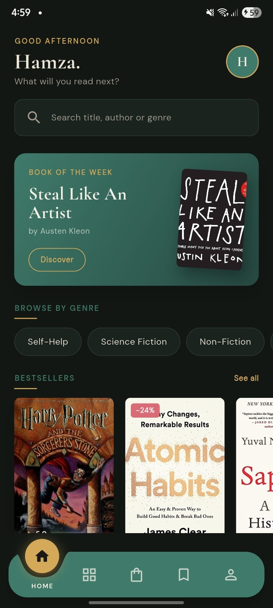
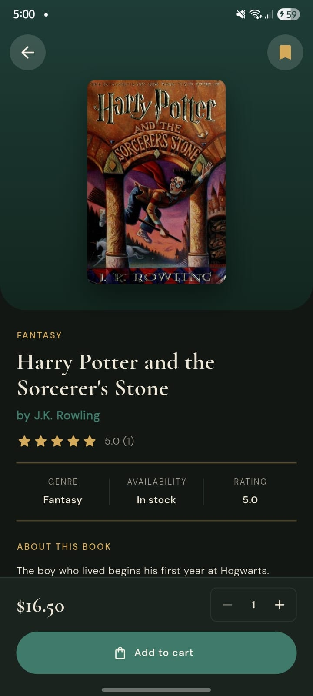
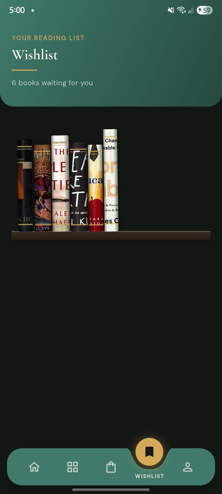

# 📚 Book Haven

### A haven for every reader.

A premium mobile bookstore, built with Flutter and Supabase.
Discover, collect and order your next favourite book, wrapped in a literary-magazine experience.

---

## ✨ What is Book Haven?

Bookstores used to be places you could get lost in. Book Haven brings that feeling to your phone.

It is a complete book-shopping app, from the first splash screen to the delivered parcel, designed to feel more like flipping through a quiet, beautifully typeset magazine than scrolling a catalogue. Warm parchment tones, elegant serif headlines, gentle animations and a midnight-dark reading mode make every screen a pleasure to sit with.

Behind the scenes, a full admin suite lets store owners run the whole shop from the same app.

---

## 🛋️ For Readers

**Discover**
- A curated home with a featured pick, bestsellers and fresh arrivals
- Browse by genre or by author
- Fast search with recent searches, plus filters for price, rating, stock and sort order

**Fall in love with a book**
- Rich book pages with cover, description, ratings and reader reviews
- Like helpful reviews, and share your own with a star rating and comment
- Related books to keep the browsing going

**Collect**
- A **bookshelf-style wishlist** where the books you want to read next sit on a shelf
- Move wishlist books straight into your cart

**Buy with confidence**
- Smooth cart with quantity controls, swipe-to-remove with undo, and a free-delivery progress bar
- Simple checkout with saved addresses and payment options
- A satisfying order-confirmation moment

**Stay in the loop**
- Full order history with filters
- Live delivery tracking timeline for every order
- Cancel an order, or buy it all again with one tap

**Make it yours**
- Personal profile with avatar and stats
- Manage addresses and payment methods
- Light and dark themes
- Built-in Help and FAQ with a direct line to support

---

## 🛠️ For Store Owners

A dedicated admin experience, right inside the app:

- **Dashboard**: revenue, orders, customers, low-stock alerts, recent orders and top sellers at a glance
- **Manage Books**: search, filter, add, edit and remove titles, including cover uploads
- **Manage Orders**: search every order, filter by status, and move orders through the delivery pipeline with notes
- **Manage Users**: browse customers, review their activity and promote or demote admins

---

## 🎨 Design Language

**Modern Editorial, "Ink & Parchment."**

| | |
|---|---|
| **Mood** | Literary magazine, calm, premium |
| **Palette** | Forest green, antique gold, warm parchment |
| **Typography** | Cormorant Garamond headlines with DM Sans body text |
| **Dark mode** | The *Midnight Library* |
| **Details** | Hero cover transitions, bookmark-ribbon wishlist icon, staggered fade-ins, soft cover shadows, thin gold dividers |

---

## 🧱 Built With

- **Flutter & Dart** for a smooth, native-feeling Android experience
- **Supabase** for authentication, Postgres database and image storage
- **Riverpod** for state management
- **go_router** for navigation
- Row-level security and server-side functions that keep every customer's data private and every admin action protected

---

## 📱 At a Glance

| | |
|---|---|
| **Screens** | 26 |
| **Roles** | Reader and Admin |
| **Sign-in** | Email and password, Google, OTP password reset |
| **Themes** | Light and dark |
| **Platform** | Android |

---

## 🖼️ Screenshots

<!-- <!-- Add screenshots here, e.g.: -->

  
  
  

<!-- --> 

---

## 🎓 About the Project

Book Haven was created as an **Aptech eProject** (4th Semester End), a real-life scenario in which a well-established bookseller moves from shelves to screens and needs an app that keeps the charm of a physical bookshop while delivering the convenience of modern e-commerce.

---

## 👤 Author

**Hamza**
Student developer at Aptech Learning, building real-world apps one phase at a time.

---

*Every reader deserves a haven.* 📖

